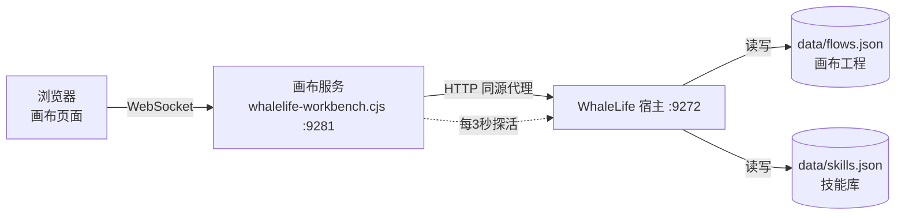
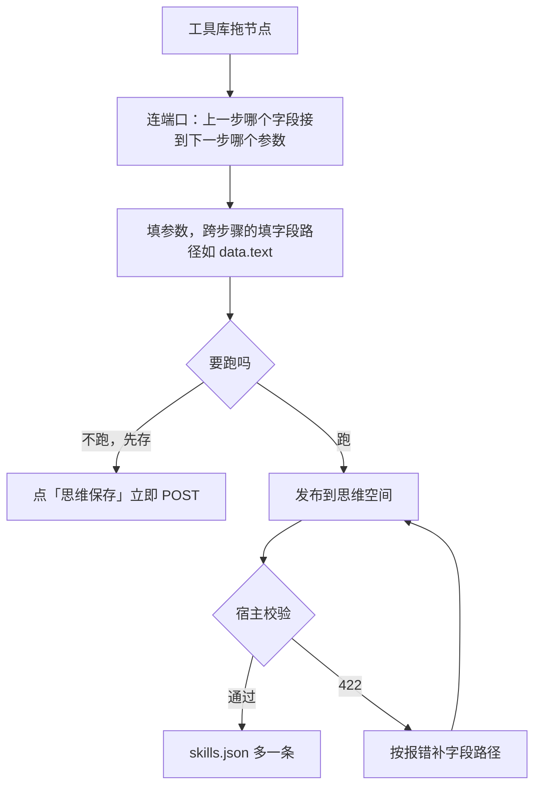

# 使用方法 · 思维画布（子插件）

画布是子插件 `thinking-space/canvas`，自带一个本地小服务，把浏览器里的流程图和宿主连起来。
**它只画画和发布，不执行**——真正跑技能还是 `space_run`。

这份只讲画布。技能定义格式见 [使用-思维空间.md](使用-思维空间.md)。

---

## 一、结构和数据流



要点：画布**不直接读磁盘**，全部走宿主 HTTP。所以宿主不开，画布画得出来，但保存不了。

```
画布内存 ──3秒后自动──> POST /plugins/thinking-space/flows ──> flows.json
flows.json ──10秒轮询──> 本地没改动就直接换新；有改动就弹提示条，不静默覆盖
技能库   ──点“同步宿主技能组”──> GET /plugins/thinking-space/skills
画布流程 ──点“发布到思维空间”──> POST /plugins/thinking-space/publish ──> skills.json
```

---

## 二、启动

```
1  宿主在跑（画布自己读 config/config.json 的 web.port，读不到就不启动）
2  插件页面 → 思维空间 →「思维画布」子插件页 → 点「启动画布」
3  浏览器打开 http://127.0.0.1:9281/
```

命令行等价：

```bash
node whalelife-workbench.cjs --port 9281 --upstream 9272
```

| 设置项 | 默认 | 说明 |
|---|---|---|
| 端口 | 9281 | 和宿主端口相同会拒 |
| 脚本路径 | 空=用包内那份 | 一般不用填 |
| 思维空间停掉时画布一起收 | 勾 | 父停 → 子停 → 画布进程被 `taskkill` |

**画布进程跟着子插件走**：在外面手动起的画布不归它管；不过画布自己有看门狗，宿主端口连不上两次就退出。

---

## 三、四个标签怎么用

```
工具库        宿主真装了的工具（点「同步插件库」只留这些）
功能库        单步流程
复合功能库    多步流程
技能组        宿主技能库里的技能，按功能组 / 复合功能组排
```

### 工具库

点「同步插件库」→ 带时间戳向宿主要一次目录，清掉宿主没有的条目。
点完右边会多出「恢复内置清单」，退回原样（内置示例、静态清单、自注册工具都回来）。

**降级情况**：宿主没有 `catalog()` 时，插件归属、危险等级、输出端口都显示「未声明」，
这是拿不到，不是坏了。

### 技能组

进页面会静默同步一次；点「同步宿主技能组」清缓存重读。每条卡片显示名称、单步/复合、
步数、危险级、状态、revision，下面一行是工具链顺序：

```
canvas_status → canvas_status
```

这一页**只读**，用来对照"画布上的流程"和"库里实际存的技能"是不是同一份。

---

## 四、画一条流程并发布



举例：一条两节点的画布流程

| 节点 | 工具 | 参数 |
|---|---|---|
| n1 | `canvas_status` | 无 |
| n2 | `canvas_status` | 无 |

发布后生成的技能（实测回执）：

```
publish 200 {"ok":true,"id":"test-publish-chain","created":true,"revision":1}
回读：含 ${n1.data.text}
```

带跨步骤传值时，连线要填字段路径：

```
n1 → n2 的参数 text      字段路径填 data.text
最终存成  "text": "${n1.data.text}"
留空或被校验器拒绝 →  422，原因原样显示，不保存
```

---

## 五、两个自动行为，别被吓到

**1. 自动保存是 3 秒防抖**
改动后 3 秒才 POST；点「思维保存」立即发。**无条件整份覆盖**宿主那份，
两个窗口同时开着改，后保存的盖掉前一个，不会有提示。

**2. 每 10 秒对一次服务端快照**

| 本地状态 | 行为 |
|---|---|
| 没有未保存改动 | 直接采用服务端版本并重载 |
| 有未保存改动 | 顶部弹提示条：「载入服务端版本」/「保留本地」 |
| 处于冲突中 | 自动保存暂停，不会把服务端新数据盖回去 |

---

## 六、连接状态

画布不按"总时长"断线，而是**每 20 秒探一次 `/api/status`**：

- 连续两次没应答 → 才判断开，并说清是宿主不应答
- 连接被关闭但宿主还应答 → 显示"连接被关了，但宿主还应答着"，不谎报宿主掉线
- 总时长上限 30 分钟

**看到「缺少 reasoning_content，未执行本次工具调用」不是画布掉线**，是宿主和模型代理的
思考模式协议不匹配（模型名被判定为思考模型，但中转没回 `reasoning_content`）。规避：
给那个 provider 配 `parameters.thinking.type = "disabled"`，或换模型名。

---

## 七、URL 参数

| 参数 | 作用 |
|---|---|
| `?flow=<流程id>` | 打开后居中到这条流程 |
| `?node=<节点id>` | 顺便选中某个节点 |
| `?skill=<技能id>` | 从技能库取一条技能，注入成节点并选中 |

---

## 八、常见失败

| 现象 | 原因 / 处理 |
|---|---|
| `Failed to fetch` | 9281 上没有服务，先点「启动画布」 |
| 点启动没反应 | 宿主端口读不到，画布拒启动，看子插件设置页的提示 |
| 连的是别的实例 | 手动起的画布没带 `--upstream`，默认 9270 |
| 「载入服务端版本」按钮看不见字 | 旧版样式问题，已修（白底深字） |
| 发布 422 | 跨步骤连线没填字段路径 |
| Linux/macOS 上启停失败 | `taskkill`/PowerShell 只在 Windows 验过，手动 `node whalelife-workbench.cjs` |
